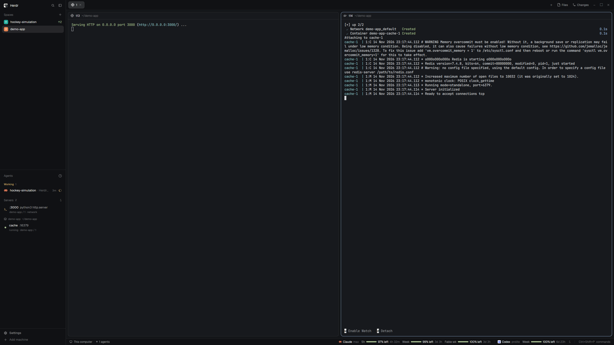

# Herdr Custom Layout



This custom layout for the Herdr desktop app shows the servers your terminals are running and how much of each agent's plan you have left. [Herdr](https://herdr.dev)

- **Clearer space and agent icons.** Spaces use colored project glyphs (folder, code, web, server, database, or terminal), selected from their names. Agents keep their recognizable logos in consistent badges, with a fallback for unknown programs. The collapsed sidebar shows icons with names on hover.
- **Agents and Servers selector.** The sidebar opens on **Agents** and shows one list at a time. The selector stays visible as you scroll. **Servers** shows a count when servers are present. Click ↻ in **Servers** to scan again. A **Needs you** dot marks **Agents** when an agent needs attention while you view **Servers**. The collapsed sidebar keeps the agent icons and a single shortcut that opens **Servers**.
- **Server ports and logs.** Web and API servers started in Herdr show their ports and log sources. Ports without a matching space appear in **Unassigned**, which starts folded. Click a server to follow its log files or peek at its terminal output. Use **keep** in the peek to open it as a tab. Hover for a `:port ↗` button that opens the server in your browser.
- **Docker containers.** Compose services show under their project. Standalone containers with published TCP ports show under **Docker**. Click a container to follow its logs. Hover a Compose project header and click **logs** to see all services together. Clicking again reuses the live logs terminal.
- **Plan usage in the status bar.** Claude and Codex each get a compact shaded group with labeled percentages remaining, including per-model weekly limits. A single “Left” label applies to all percentages. Green means at least 50% left, yellow below 50%, and red below 20%. Hover a percentage for usage and reset time; hover the agent for its plan or error details. Narrow windows show agent icons instead of names, keeping every limit label and percentage. ↻ refreshes usage (also checked automatically every 5 minutes). An agent you haven't logged into is left out.
- **Tabs named after their agents.** A tab running an agent takes the title the agent gives its terminal: Claude Code names it after the conversation's topic, so tab `1` becomes `Fix login redirect` and follows the topic as it changes. A tab you name yourself keeps your name (rename it to nothing to hand it back). Turn off **Name tabs after agents** in the **Agents** sort menu.
- **Open files in your editor.** Right-click a file or folder in **Files**, or a changed file in **Changes**, to open it in Zed or VS Code, with the default app, or in Finder. The editor opens the file in its project's window. An editor that isn't installed shows as not installed.
- **Based on Herdr's main layout.** The spaces and agents lists add icon badges. The status bar adds plan usage. Files and Changes add a right-click menu.

## Install

Ask your Herdr agent to "add the layout at github.com/j-nguyen/herdr-custom-layout".

Or by hand: clone this repository and link the mods into Herdr's home:

```sh
git clone https://github.com/j-nguyen/herdr-custom-layout.git ~/herdr-custom-layout
ln -s ~/herdr-custom-layout/mods/spaces-icons ~/.config/herdr-app/mods/spaces-icons
ln -s ~/herdr-custom-layout/mods/agents-servers ~/.config/herdr-app/mods/agents-servers
ln -s ~/herdr-custom-layout/mods/status-usage ~/.config/herdr-app/mods/status-usage
ln -s ~/herdr-custom-layout/mods/files-open ~/.config/herdr-app/mods/files-open
ln -s ~/herdr-custom-layout/mods/changes-open ~/.config/herdr-app/mods/changes-open
ln -s ~/herdr-custom-layout/mods/open-with ~/.config/herdr-app/mods/open-with
cp ~/herdr-custom-layout/layouts/main-custom.json ~/.config/herdr-app/layouts/
herdr-app check ~/.config/herdr-app/mods/spaces-icons
herdr-app check ~/.config/herdr-app/mods/agents-servers
herdr-app check ~/.config/herdr-app/mods/status-usage
herdr-app check ~/.config/herdr-app/mods/files-open
herdr-app check ~/.config/herdr-app/mods/changes-open
herdr-app check ~/.config/herdr-app/mods/open-with
herdr-app do layout.switch --name main-custom
```

`main-custom` is Herdr's own `main` layout (0.1.15) with the spaces and agents blocks, the Files and Changes blocks and the status bar swapped for these mods. `ctrl-shift-l` switches back to any other layout.

Herdr doesn't notice changes inside a symlinked mod folder, so after a `git pull` restart Herdr (or make the links again) to load the new version.

### Your own layout

In a layout of your own, point the agents block and the status bar at these mods:

```json
{ "id": "spaces", "type": "block", "size": { "weight": 1 }, "min": 90, "content": { "mod": "spaces-icons" } }
{ "id": "agents", "type": "block", "size": { "weight": 1 }, "min": 90, "content": { "mod": "agents-servers" } }
{ "id": "status", "type": "block", "size": { "px": 28 }, "content": { "mod": "status-usage" } }
{ "id": "files", "type": "block", "content": { "mod": "files-open" } }
{ "id": "changes", "type": "block", "content": { "mod": "changes-open" } }
```

The right-click menu needs the `open-with` mod linked too.

Each works without the others.

## Requirements

- **Servers**: Linux or macOS, with `python3`. Linux uses `ss` and `/proc`; macOS uses `lsof` and `ps`. Compose services need the `docker` CLI. Not on Windows yet.
- **Usage**: a Claude Code login (`~/.claude/.credentials.json`, or the macOS Keychain) and/or a Codex ChatGPT login (`~/.codex/auth.json`). OpenCode signed in with ChatGPT shares Codex's limits.

## What it reads and sends

Before installing, know that these mods:

- **Read the agents' saved logins** and send each token only to that agent's own service, every 5 minutes: Claude Code's to `api.anthropic.com/api/oauth/usage`, Codex's to `chatgpt.com/backend-api/wham/usage`. Tokens stay in memory; nothing is written or logged. These are the endpoints the agents use themselves, not documented public APIs, so a service change can break a meter (it then shows an error, never wrong numbers).
- **Scan ports and log sources** every 4 seconds with `python3`, `ss` or `lsof` and `ps`, and `docker ps`. The scan checks the process and its parents for `HC_TERMINAL_ID`. It checks where stdout and stderr go, including when a parent process forwards them. Clicking a row can run `tail -F`, `docker logs --follow`, or `docker compose logs -f` in a Herdr terminal. The browser button runs `xdg-open` on Linux and `open` on macOS.
- **Run an editor when you pick it** from the right-click menu: Zed's or VS Code's command line tool from inside the app (`/Applications/<app>.app`, or on Linux `zed`/`code` on `PATH`), `open` (`xdg-open` on Linux). When the menu opens, it checks which of those editors exist.
- Rename tabs (`tab.rename`) that have an agent in them and nobody else named, with that agent's terminal title.

## Limits

- Host processes need a Herdr terminal ID to appear. Docker containers appear through Docker's own port list.
- Host process ports 32768 and up are left out. Docker can publish a port in that range and still appear.
- This computer only: spaces on other machines don't show their servers yet.
- GitHub Copilot usage isn't supported yet.
- The right-click menu works on macOS and Linux, for spaces on this computer only. Deleted files in Changes have no menu.
- Tab names come from the terminal title, so an agent that sets none (or only its own name) leaves its tab numbered.

## License

MIT (`LICENSE`). The mods started as copies of the spaces, agents, workspace-status, files, changes and menu mods that ship with [Herdr](https://herdr.dev); that code keeps Herdr's Apache License 2.0 (`LICENSE-APACHE`).
