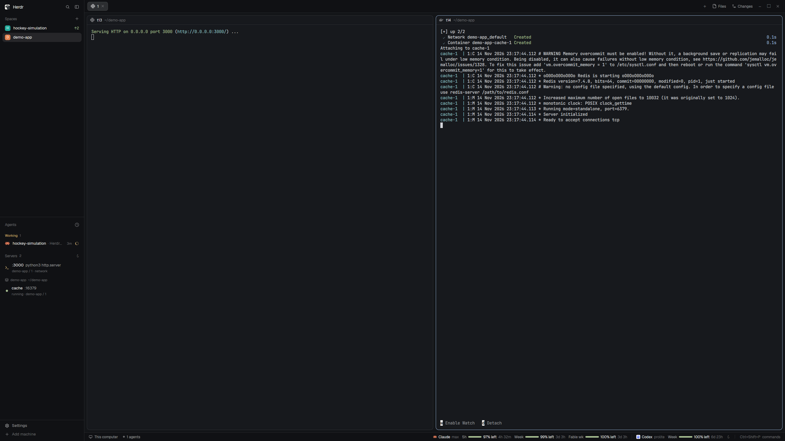

# Herdr Custom Layout

This custom Herdr layout lists servers under the agents and shows plan usage in the status bar. Click a server to see its logs.

## What you see

Left to right, top to bottom, as Herdr's `main`, except:

- **Space icons**: `spaces-icons` preserves the spaces list behavior and replaces initials with 22px colored glyph badges selected from the space name. Compact rows show 20px badges with name tooltips. Agent logos sit in 24px badges (20px for sub-agents and the collapsed sidebar), with a generic agent glyph when a program has no icon.
- **Servers, under the agent rows** in the Agents block, in the same scroll. A header like the Agents one: "Servers" in `dim` 11.5px medium, the count in `dim` 11px, a ↻ on the right (12px `dim`, `foreground` on hover). 16px above it, 5px below.
- **A port row** uses Herdr's terminal glyph. The first line shows the port and process. The second line shows the log file or terminal tab, followed by `local` or `network`.
- **Group headers**, styled like the agents' space headers: 8px above, 30px tall, `dim` 11px medium, `foreground` on hover. Port rows go under a header per space, in the spaces' order (`Other` last, for a terminal with no space). Each Compose project gets its own header after them, with Herdr's layers icon 12px before the name and a tooltip `project  ~/its/folder` (home as `~`; deeper than three parts, `…/` and the last two). Clicking a header folds its group. Folded, it shows the count, a 7px `blocked` dot when a service is unhealthy, and a right chevron. Hovering a project header shows `logs` on its right (11px `muted`, `raised` on hover).
- **A container row** shows a status dot, the service or container name, and its published TCP ports. The second line shows state and health. Standalone containers with published TCP ports share the **Docker** group. The tooltip shows the container name and status.
- Hovering a row shows `:port ↗` on its right (11px `muted`, `raised` on hover).
- The empty state explains which servers appear. A failed scan or a stopped Docker daemon shows its error in the list.
- **Right-click menu** on a Files row (file or folder) and a Changes row, at the pointer, 240px wide, styled as Herdr's own right-click menu (`popover` background, 31px rows, 14px icons from `mods/workspace-chrome/` in `muted`): `Open in Zed`, `Open in VS Code` (`square-pen`); a divider; for a file `Open with default app` (`file-text`) and `Reveal in Finder` (`folder`), for a folder `Open in Finder` (on Linux: `Open containing folder`, `Open folder`). An editor that isn't installed is `dim` with `not installed` on the right. The picked row shows `opening…` until the command returns.
- Sidebar folded to a rail: under the agents, a divider and one 26px cell per server with its port number, 10.5px `muted`, tooltip naming it.
- **Tabs named after their agents**: an unnamed tab with an agent shows that agent's terminal title (its leading status glyph removed, at most 40 characters, `…` after), e.g. `Herdr-app AGENTS.md`.
- The sort menu (the sort button right of "Agents") gains a divider and **Name tabs after agents**, checked when on; the popup is 220×186.
- **Usage in the status bar**, right-aligned before the palette hint: one “Left” label, then a compact group per agent with a `raised` background, 4px corners, 20px height, and 8px horizontal padding. Each group contains its 13px icon, name, and labeled percentages (`5h`, `Week`, per-model limits). Percentages use `ansi2`, `ansi3` under 50% left, and `ansi1` under 20%. Hover a percentage for usage and reset time, or the agent group for its plan or error details. Below 1000px, omit provider names but retain icons, limit labels, and all percentages. A ↻ refresh button follows the groups.
- The status bar under 1500px wide drops the words (`97%`, no plan, `Codex` alone) and uses 28px bars; under 1150px it drops bars and reset times and colors the percentages instead.

## How it behaves

- Clicking a port row follows its stdout and stderr files with `tail -F` when available. It peeks at the terminal when that terminal receives the server output. A port with neither source shows **Logs unavailable**.
- Clicking a container row follows that container's output with `docker logs --follow --tail 200 <container-id>`. The mod starts each file or Docker log follower with `hc run --bg`, waits for Herdr to list it, then peeks at it. The label identifies the live terminal to reuse on the next click.
- Clicking **logs** on a Compose project header peeks at an attached terminal for the whole project when available. Otherwise it runs `docker compose -p <project> logs -f --tail 200`.
- `:port ↗` opens `http://localhost:<port>` with `xdg-open` (`open` on macOS, `start` on Windows) without peeking.
- Servers rescan every 4 s; ↻ rescans now. Usage checks every 5 minutes; ↻ checks now; reset countdowns redraw each minute. Hovering a meter: `5h: 3% used, 97% left, resets in 4h 32m`.
- Every 3 s, each tab's first agent (pane order) names it with `tab.rename {id, name}` when its title says something about the work: not empty, not a folder (`~`, `/`), not `user@host`, not the program's own name (`Claude Code`, `codex`). A name we gave is remembered (mod `localStorage` `autotitles`, tab id → name) and follows the title; a tab named anything else was named by a person and is never touched; renaming to "" makes it unnamed, so it is named again. The toggle is `shared("agents.autotitle")` (`false` = off).
- Right-click opens `openOverlay({mod: "open-with", kind: "popup", width: 240, props: {path, dir, root}})`. `root` is the git top folder (Files: the pane's folder outside git). ↑/↓ move, Enter runs, Esc closes. An editor runs its CLI with `root` and the file, so it opens the file in that project's window. Default app: `open <path>` (`xdg-open`). Finder: `open -R <path>`, a folder `open <path>`. A failure posts an error notification. No menu for a space on another machine, a deleted file in Changes, or on Windows.
- Agent states (working, blocked, done, idle) in the agent rows are Herdr's own, unchanged.
- An agent with no saved login is left out of the bar; an expired login, HTTP error or network failure shows a short message in `blocked` for that agent.

## Built from

- **Layout** `layouts/main-custom.json`: Herdr's `main` 0.1.15 (`layout.clone`) with the `agents` block's mod set to `agents-servers`, the `files` block's to `files-open`, the `changes` block's to `changes-open` and the `status` block's to `status-usage`.
- **Mod** `mods/agents-servers/` extends Herdr's `agents` mod. `main.js` starts `AutoTitle` and `Servers`. `servers.js` calls `python3 -I scan.py` and uses the JSON fields `ports`, `compose`, `containers`, and `docker_error`.
  - `ports` contains TCP listeners below port 32768 from `ss` or `lsof`. The scan checks the process and its parents for `HC_TERMINAL_ID`. It follows stdout and stderr to a file or terminal. It can follow an output channel through a parent process that holds the receiving end. Linux uses `/proc` and macOS uses `ps` and `lsof`.
  - `compose` contains running Compose services. Each service carries its project label, working directory, and the attached project terminal when available. `containers` contains standalone containers with published TCP ports.
- **Mods** `mods/files-open/` and `mods/changes-open/`: `mod.clone` of Herdr's `files` and `changes` (0.1.15), each row with `on_mouse_down("right")` opening the menu. `files-open` keeps the git top folder from its refresh as `top`.
- **Mod** `mods/open-with/`: the menu, a copy of Herdr's `menu` mod's look. Finds editors with `sh -c` (`[ -x ]` for an absolute path, since macOS `sh` answers `command -v` for any absolute path; `command -v` for a name): macOS `/Applications/` and `~/Applications/` `Zed.app` or `Zed Preview.app` `Contents/MacOS/cli`, `Visual Studio Code.app` `Contents/Resources/app/bin/code`; Linux `zed`, `zeditor`, `code`. A mod can't import a file from another mod's folder, so the menu is its own mod.
- **Mod** `mods/status-usage/`: `mod.clone` of Herdr's `workspace-status` (0.1.15). `main.js` makes a `Usage` (`usage.js`), tracks its width with `on_size_change`, and adds `usage.render(t, mode)` and a divider before the palette hint. `usage.js` `fetch`es:
  - Claude Code: `GET https://api.anthropic.com/api/oauth/usage` with `Authorization: Bearer <claudeAiOauth.accessToken>` and `anthropic-beta: oauth-2025-04-20`, the token from `~/.claude/.credentials.json`, else on macOS `security find-generic-password -s "Claude Code-credentials" -w`. Meters from `limits[]` (`session` → 5h, `weekly_all` → Week, `weekly_scoped` → `<model> wk`, `percent`, `resets_at`), else `five_hour`/`seven_day` `utilization`.
  - Codex: `GET https://chatgpt.com/backend-api/wham/usage` with `Authorization: Bearer <tokens.access_token>` and `ChatGPT-Account-Id: <tokens.account_id>` from `~/.codex/auth.json`. Meters from `rate_limit.primary_window`/`secondary_window` (`used_percent`, `limit_window_seconds` 18000 → 5h, 604800 → Week, `reset_at` seconds).
- **herdr**: `agents`, `terminals` (`where`, `labels`, `state`), `spaces`, `run` (`terminal.peek`), `exec`, `hc`, `readTextFile`, `knownAgents` (icons), `home`, `appHome`, `theme`, `window` (`platform`). Icons are Herdr's own from `mods/workspace-chrome/` and the program table.

## Watch out

- Herdr's shipped mods are read-only: clone them (`mod.clone`) and point a cloned layout at the clones; never edit `agents` or `workspace-status` in place.
- A layout block can't size to its content, so a separate Servers block under Agents leaves a gap: drawing the servers inside the agents list is what puts them right under the last agent.
- `ss` shows the owning process only for your own processes, and `docker-proxy` runs as root: Compose ports come from `docker ps`, never from `ss`.
- An agent listens on a loopback port of its own (Claude Code does): skip agent processes by name or every agent shows up as a server.
- `hc run` from a mod has no parent terminal; from an agent's shell it does, and the terminal shows under that agent as a sub-agent.
- The usage endpoints are what the agents' own clients call, not documented APIs. Send a `User-Agent`; treat 401/403 as an expired login. Never log or store tokens.
- Status bar room runs out fast: measure the bar's own width (`on_size_change`) and drop provider names, keeping limit labels and percentages.
- `tab.named` is true for a name a mod gave too: remember the names you set, or every auto name looks like a person's and stops following.
- Herdr doesn't reload symlinked mod folders on change; restart after `git pull`.

## Done when

- `herdr-app check` passes for every mod and `herdr-app do layout.switch --name main-custom` shows the layout with no errors in `herdr-app status`.
- `python3 -m http.server 3000` in a Herdr terminal shows `:3000 python3 http.server` with that terminal's space and tab within 4 seconds; clicking it peeks at its output; `:3000 ↗` opens the page; stopping it removes the row.
- A Next.js worker appears when its parent carries the terminal ID. A Node server that redirects output to a file opens that file's live logs from its port row.
- Compose and standalone containers open their own logs from their rows. A Compose project header opens all its services' logs. Clicking again reuses the live logs terminal.
- Right-clicking a file in Files or Changes shows the menu at the pointer; `Open in VS Code` opens the file in the window of its git folder; `Reveal in Finder` selects it in Finder; an editor that isn't installed is dimmed and does nothing.
- The status bar shows Claude Code's 5h and Week meters and Codex's meter with the same percentages as `/usage` in Claude Code and `/status` in Codex; an agent without a login isn't there.
- A Claude Code tab named `1` becomes its topic within a few seconds; renaming the tab by hand stops it changing; renaming it to "" brings the topic back; unchecking **Name tabs after agents** stops it.
- Narrowing the window drops provider names while every limit label and percentage stays.
